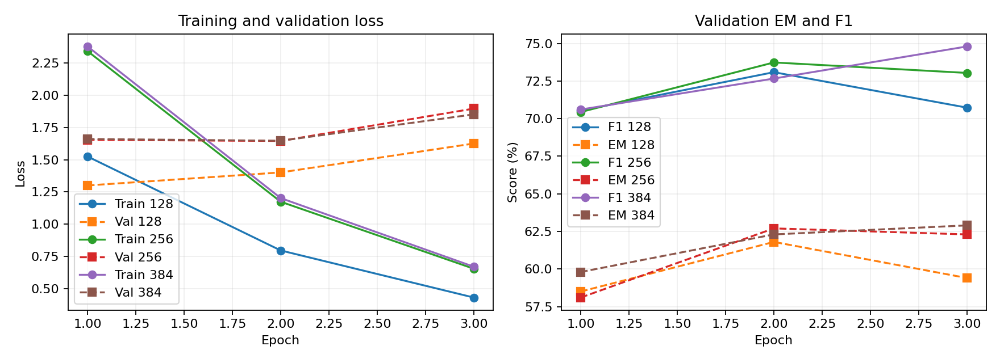
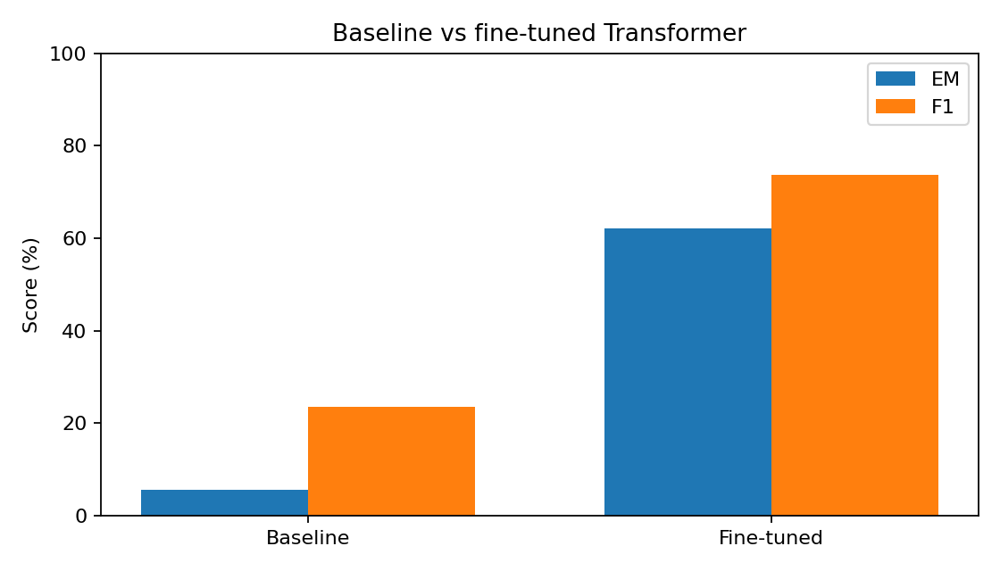
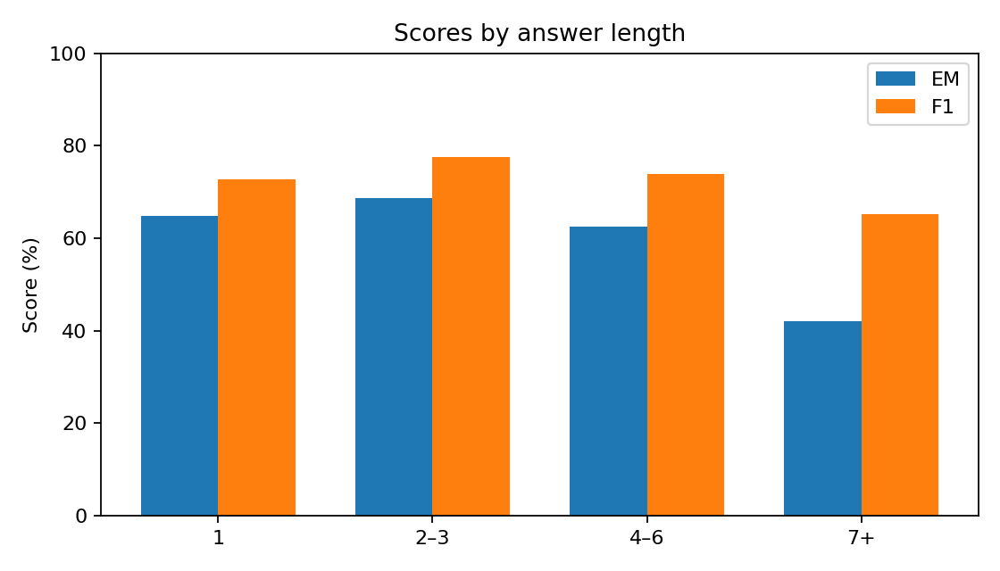

# LAB 10 — Extractive Question Answering

## Mục tiêu

Xây dựng hệ thống Extractive QA trên SQuAD 1.1 bằng DistilBERT, triển khai start và end classifier, căn chỉnh answer span, đánh giá EM và F1, phân tích lỗi và xây dựng Document QA.

## Reproducibility

| Thành phần | Giá trị |
|---|---|
| Model | distilbert-base-uncased |
| Tokenizer | distilbert-base-uncased fast |
| Dataset | SQuAD 1.1, rajpurkar/squad |
| Train split | 8000 mẫu từ train chính thức |
| Validation split | 1000 mẫu từ validation chính thức |
| Test split | 1500 mẫu từ validation chính thức |
| Max sequence length | 128, 256, 384 |
| Stride | 32 |
| Batch size | 8 |
| Learning rate | 3e-5 |
| Epochs | 3 |
| Optimizer | AdamW |
| Random seed | 42 |
| Hardware | Tesla T4 |
| Training time | 128: 693.61 s; 256: 686.90 s; 384: 959.33 s; tổng: 2339.84 s |

Validation và test được tách theo context để tránh trùng đoạn văn. Train không chứa context xuất hiện trong validation hoặc test. Các thí nghiệm dùng chung split và cấu hình, chỉ thay đổi max sequence length. Stride được giữ ở 32 vì input 128 không thể luôn dùng overlap 128. Notebook tokenizer alignment minh họa riêng cấu hình max length 384 và stride 128 theo đề bài. Question dài hơn 64 token được cắt về giới hạn chung. Các window không chứa đầy đủ answer được gán target CLS. Khi dự đoán chỉ xét span trong context, tối đa 30 token, end không nhỏ hơn start. SQuAD 1.1 chỉ gồm câu hỏi có đáp án.

Thời gian huấn luyện được tính từ đầu vòng lặp epoch đến khi kết thúc validation cuối, không gồm tải model, tokenization và đánh giá test.

## Cách chạy

Giải nén ZIP và mở thư mục lab10. Trên Google Colab, mở notebook và chạy cell đầu để tải ZIP, giải nén và cài thư viện. Hai notebook `tokenizer_alignment.ipynb` và `qa_finetuning.ipynb` chạy độc lập. Notebook fine-tuning cần GPU. Không cần chạy lại lệnh huấn luyện bên dưới nếu đã chạy notebook.

Chạy từ terminal:

```bash
pip install "torch>=2.4,<3" "transformers==4.48.3" "datasets==3.2.0" "matplotlib>=3.7,<4" "pandas>=2,<3"
python qa_model.py
python document_qa.py "When was the Transformer architecture introduced?"
```

Dùng tài liệu riêng:

```bash
python document_qa.py "What is the main contribution?" --document document.txt
```

## Thực nghiệm

| Experiment | Phương pháp |
|---|---|
| Context length | Huấn luyện độc lập ở 128, 256 và 384 token |
| Pretrained QA model | Fine-tune DistilBERT với QA head tuyến tính và loss trung bình của hai cross entropy |
| EM vs F1 | So sánh baseline keyword overlap với model 384 |
| Question/context matching | Chia nhóm theo tỷ lệ từ khóa question xuất hiện trong câu chứa gold, ngưỡng 0.5 |
| Answer length | Chia nhóm theo số subword token của gold đầu tiên: 1, 2–3, 4–6, 7+ |
| Irrelevant information | Thêm hai câu không liên quan, giữ gold |
| Distractor | Thêm một câu chứa nguyên question nhưng không chứa câu trả lời chủ đích |
| Sentence order | Đảo thứ tự câu và cập nhật character offset, chỉ dùng mẫu có gold không vượt biên câu |

EM và F1 được tính trên prediction text đã lowercase, bỏ dấu câu, article và chuẩn hóa khoảng trắng. F1 sử dụng số token trùng theo multiset. Nếu có nhiều gold, lấy điểm cao nhất cho từng metric. EM và F1 trong results.csv được biểu diễn từ 0 đến 100. Lexical overlap chỉ là chỉ báo gần đúng về mức độ tương đồng từ vựng, không phải nhãn ngữ nghĩa thủ công.

## Kết quả

### Context length

| Max length | EM | F1 | Training time, s | Test loss |
|---:|---:|---:|---:|---:|
| 128 | 61.33 | 72.13 | 693.61 | 1.5581 |
| 256 | 62.33 | 72.85 | 686.90 | 1.7899 |
| 384 | 62.13 | 73.73 | 959.33 | 1.8595 |

Max length 256 đạt EM cao nhất, còn 384 đạt F1 cao nhất. Tăng max length không luôn cải thiện EM và có thể làm tăng chi phí tính toán.

### Baseline và fine-tuned Transformer

| Model | EM | F1 |
|---|---:|---:|
| Keyword overlap | 5.53 | 23.51 |
| DistilBERT | 62.13 | 73.73 |

Fine-tuned DistilBERT với max length 384 tăng 56.60 điểm EM và 50.22 điểm F1 so với baseline.

### Learning curves

Ở max length 384, training loss giảm từ 2.3787 xuống 0.6698. Validation loss giảm từ 1.6608 xuống 1.6470 ở epoch 2 rồi tăng lên 1.8518 ở epoch 3. Validation F1 tăng từ 70.61 lên 74.80. Khoảng cách giữa training loss và validation loss tăng, cho thấy dấu hiệu overfitting theo loss. Kết quả test sử dụng model sau epoch 3.





### Question/context matching

| Lexical overlap | Số mẫu | EM | F1 |
|---|---:|---:|---:|
| High | 999 | 67.07 | 78.01 |
| Low | 501 | 52.30 | 65.18 |

Nhóm overlap cao đạt kết quả tốt hơn. Đây là mối liên hệ quan sát được, chưa đủ để kết luận model chỉ dựa vào từ khóa.

### Answer length

| Answer length | Số mẫu | EM | F1 |
|---|---:|---:|---:|
| 1 | 293 | 64.85 | 72.81 |
| 2–3 | 561 | 68.63 | 77.55 |
| 4–6 | 418 | 62.44 | 73.84 |
| 7+ | 228 | 42.11 | 65.29 |

Nhóm 2–3 token đạt kết quả cao nhất. Nhóm 7+ token có EM thấp nhất, cho thấy khó xác định chính xác hai biên của span dài.



### Controlled experiments

| Experiment | Số mẫu | EM trước | EM sau | F1 trước | F1 sau |
|---|---:|---:|---:|---:|---:|
| Irrelevant information | 1500 | 62.13 | 62.47 | 73.73 | 73.89 |
| Distractor | 1500 | 62.13 | 47.33 | 73.73 | 55.40 |
| Sentence order | 1440 | 62.22 | 60.90 | 73.90 | 72.14 |

Thông tin không liên quan làm thay đổi điểm rất ít, trong khi distractor gây suy giảm rõ rệt. Đảo thứ tự câu làm giảm nhẹ EM và F1 trên tập con có thể đảo câu mà vẫn giữ gold.

### Error analysis

Trên 1500 câu test, có 185 lỗi chỉ sai start, 123 lỗi chỉ sai end và 333 lỗi sai cả hai biên. Tổng số sai start là 518 và tổng số sai end là 456. Có 333 câu EM bằng 0 nhưng F1 lớn hơn 0. Chi tiết các ví dụ trong error_analysis.md. Sai biên ký tự không đồng nhất với sai EM vì EM sử dụng normalization và nhiều đáp án chuẩn.

### Document QA

| Question | Prediction | Start | End exclusive |
|---|---|---:|---:|
| When was the Transformer architecture introduced? | 2017 | 47 | 51 |
| What does extractive question answering predict? | the start and end positions of an answer in a context | 133 | 186 |
| What articles is SQuAD based on? | Wikipedia | 251 | 260 |

Ba câu hỏi đều có đáp án phù hợp với tài liệu. Notebook fine-tuning đã thực hiện Document QA bằng checkpoint sau huấn luyện.

Hai notebook lưu output thực tế từ Colab. Checkpoint không có trong bản nộp vì dung lượng lớn và sẽ được tạo lại khi chạy fine-tuning. Kết quả nộp nằm trong results.csv, các biểu đồ và output notebook. Các file history.csv, reproducibility.json, predictions.json, split_ids.json và experiment_analysis.md được tạo lại khi chạy fine-tuning.

## Extractive QA và RAG

Extractive QA nhận question và context đã có để dự đoán answer span. RAG tìm tài liệu liên quan qua retriever rồi chuyển context tới generator hoặc QA model. Document QA trong lab này không thực hiện retrieval và không hỗ trợ xác định no-answer. SQuAD 2.0 là phần mở rộng tùy chọn chưa triển khai.


## Individual Learning Check

### 1. Extractive QA khác classification như thế nào?

Classification dự đoán một nhãn cho input. Extractive QA dự đoán một đoạn văn bản liên tục trong context bằng start và end position dựa trên question.

### 2. Tại sao QA cần start và end position?

Answer có độ dài thay đổi nên cần cả vị trí bắt đầu và kết thúc để xác định chính xác span.

### 3. Character offset khác token index như thế nào?

Character offset là vị trí ký tự trong văn bản gốc. Token index là vị trí token trong chuỗi sau tokenization. Một token có thể chứa nhiều ký tự và một từ có thể bị chia thành nhiều token.

### 4. Tại sao cần offset mapping?

Offset mapping giúp chuyển answer span từ character position sang token position để tạo target huấn luyện và trích xuất lại answer từ context gốc.

### 5. Stride dùng để làm gì?

Stride xác định số token chồng lấn giữa các window liên tiếp, giúp giảm khả năng đáp án bị cắt tại ranh giới window.

### 6. Vì sao context dài có thể phải chia thành nhiều window?

Transformer có giới hạn chiều dài input. Chia context thành nhiều window giúp xử lý văn bản vượt quá giới hạn mà không loại bỏ toàn bộ phần phía sau.

### 7. Exact Match đo điều gì?

Exact Match đo tỷ lệ prediction trùng hoàn toàn với ít nhất một đáp án chuẩn sau normalization.

### 8. F1 của QA khác gì với accuracy?

Accuracy thường đo tỷ lệ dự đoán đúng nhãn. F1 của QA đo mức độ trùng lặp token giữa prediction và gold thông qua precision và recall, nên có thể ghi nhận đáp án đúng một phần.

### 9. Vì sao prediction có thể có F1 > 0 nhưng EM = 0?

Prediction có thể chứa một phần token của gold nhưng không trùng hoàn toàn. Ví dụ gold là New York City và prediction là New York thì F1 = 0.8 và EM = 0.

### 10. Wrong start và wrong end khác nhau như thế nào?

Wrong start xảy ra khi vị trí bắt đầu sai. Wrong end xảy ra khi vị trí kết thúc sai. Nếu gold là New York City thì York City sai start, còn New York sai end.

### 11. Extractive QA khác RAG ở đâu?

Extractive QA nhận trực tiếp question và context rồi trích xuất answer. RAG có thêm bước retrieval để tìm tài liệu liên quan trước khi tạo hoặc trích xuất câu trả lời.

### 12. Khi nào extractive QA không thể trả lời câu hỏi?

Extractive QA không thể trả lời đúng khi context không chứa span đáp án phù hợp, thông tin bị mất do truncation hoặc câu hỏi đòi hỏi tổng hợp và suy luận mà đáp án không xuất hiện dưới dạng một đoạn liên tục.
